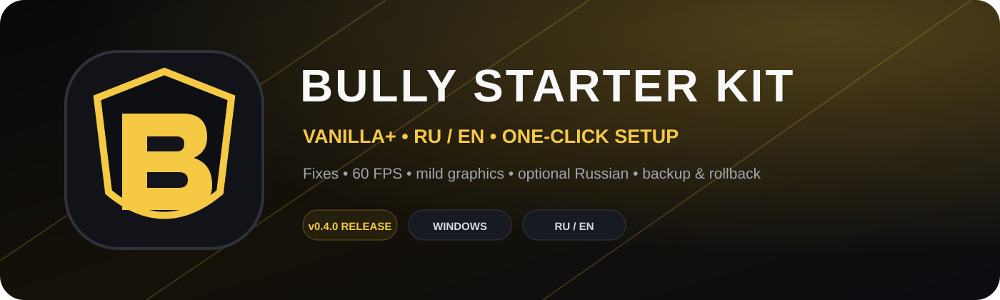
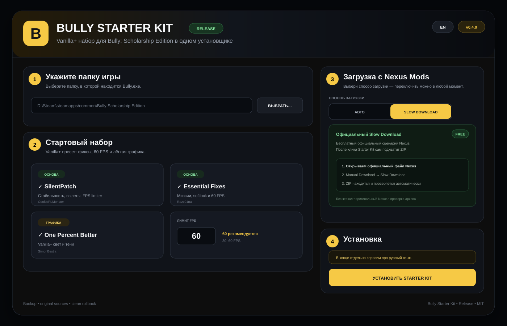

<p align="center">
  
</p>

<p align="center">
  
  
  
  
  
</p>

<p align="center">
  <b>Один запуск. Vanilla+ атмосфера. Нормальная Bully на современном ПК.</b><br/>
  Стартовый установщик для <b>Bully: Scholarship Edition (PC)</b>: фиксы стабильности, 60 FPS, лёгкое улучшение графики, резервные копии и опциональный русский язык.
</p>

<p align="center"><b>🇷🇺 Русский</b> · <a href="README_EN.md">🇬🇧 English</a></p>

> [!IMPORTANT]
> **Bully Starter Kit — неофициальный проект сообщества.** Он не содержит саму Bully и не зеркалирует архивы модов с Nexus Mods. Сторонние моды скачиваются с оригинальных источников, а их авторы и ссылки всегда указаны в проекте.

> [!TIP]
> **В релизе два режима загрузки Nexus.** **Авто** использует Nexus API и прямую Premium-загрузку; **Slow Download** работает через официальный бесплатный сценарий Nexus без обязательного API-ключа. Между режимами можно переключаться прямо в интерфейсе.

## ✦ Что устанавливается

| Компонент | Автор | Что делает | Оригинальный источник |
|---|---|---|---|
| **SilentPatch for Bully** | CookiePLMonster | Стабильность, исправления вылетов/памяти, лимит FPS | [GitHub](https://github.com/CookiePLMonster/SilentPatchBully) |
| **Razc01na's Essential Fixes & Improvements** | Razc01na | Исправления миссий, softlock-багов и совместимость с 60 FPS | [Nexus Mods](https://www.nexusmods.com/bullyscholarshipedition/mods/396) |
| **One Percent Better Project — Main** | SimonBestia | Очень лёгкое Vanilla+ улучшение освещения/теней | [Nexus Mods](https://www.nexusmods.com/bullyscholarshipedition/mods/148) |
| **Русский язык Bully** | встроен в игру | Русские интерфейс и субтитры, английская озвучка | [Подробнее](docs/RUSSIAN_LANGUAGE.md) |

Полные Credits и условия распространения: **[THIRD_PARTY.md](THIRD_PARTY.md)**.

> [!NOTE]
> **Essential Fixes теперь ставится напрямую из ZIP.** Starter Kit читает только `Main/To Scripts` и `Optional`, поэтому посторонняя структура архива больше не участвует в установке; `default.idb` не копируется.

> **One Percent Better — необязательный компонент.** Установщик берёт из официального Main ZIP только `gsa_info.dat` и копирует его в `Graphics`. Если графический мод не установится, можно продолжить с основными фиксами без отката всей установки.

## ✦ Как выглядит программа

<p align="center">
  
</p>

Интерфейс автоматически выбирает русский на русской Windows и позволяет переключаться между **RU / EN**. Все строки лежат отдельно в `locales/ru.json` и `locales/en.json`, поэтому проект можно расширять другими языками без переписывания установщика.

## ✦ Быстрый старт

1. Установите **Bully: Scholarship Edition (PC)**. Для классической PC-версии рекомендуется патч **1.200**.
2. Скачайте релиз Starter Kit и распакуйте его в отдельную папку.
3. Запустите **`Start_BullyStarterKit.bat`**.
4. Укажите папку, где лежит **`Bully.exe`** — Steam-библиотеки программа также пытается найти сама.
5. Оставьте рекомендуемые компоненты и нажмите **УСТАНОВИТЬ STARTER KIT**.
6. Выбери способ загрузки: **Авто** или **Slow Download**. В Slow-режиме Starter Kit откроет официальный Nexus и сам найдёт ZIP после твоего клика.
7. **В самом конце программа отдельно спросит: «Включить русский язык в Bully?»** Выберите Да или Нет.
8. После успешной установки можно сразу нажать **«Запустить Bully»**.

> [!TIP]
> Для первого прохождения рекомендуется **60 FPS**. Starter Kit специально сочетает SilentPatch и Essential Fixes, чтобы уменьшить проблемы миссий/скриптов на повышенном FPS.

## ✦ Русский язык игры

Starter Kit **не скачивает сомнительный сторонний русификатор**. Для Steam-версии используется встроенная русская локализация Bully: программа делает резервную копию `12200_install.vdf` и безопасно меняет языковой код на `1049`.

- интерфейс и субтитры — русский;
- озвучка — английская;
- вопрос появляется **только после установки модов**;
- ответ **Нет** вообще не меняет язык;
- изменение языка входит в обычный backup/rollback.

Подробнее: **[docs/RUSSIAN_LANGUAGE.md](docs/RUSSIAN_LANGUAGE.md)**.

### Интерфейс релиза

Интерфейс использует системный **Segoe UI** без встраивания сторонних шрифтов, ClearType-рендеринг и единые размеры текста для Windows 10/11. Переключатель **Авто / Slow Download** анимирован и меняет описание режима без перезапуска программы.

## ✦ Безопасность и откат

- резервная копия перед заменой файлов;
- новые файлы отслеживаются для чистого удаления;
- автоматический rollback при ошибке установки;
- проверка скачанных ZIP-архивов;
- защита от ZIP path traversal;
- защита от записи за пределы выбранной папки Bully;
- SHA-256 записывается для скачанных архивов;
- Nexus API key при сохранении шифруется **Windows DPAPI** для текущего пользователя;
- `RESTORE / ВОССТАНОВИТЬ` возвращает последнюю резервную копию.

## ✦ Почему моды не лежат прямо в GitHub Release

Starter Kit — установщик, а не перепаковка чужих работ. Моды остаются на оригинальных страницах авторов. Это упрощает обновления, сохраняет Credits и не превращает наш репозиторий в зеркало сторонних файлов.

Особенно важно для **One Percent Better Project**: Starter Kit не переносит его архив в GitHub Releases и получает Main-файл с оригинальной страницы Nexus.

## ✦ Два режима Nexus Mods

Starter Kit не обходит ограничения Nexus и предлагает два понятных режима:

- **Авто** — Starter Kit через Nexus API определяет актуальный файл и скачивает его напрямую. Для прямой загрузки нужен Premium и API key.
- **Slow Download** — официальный бесплатный поток Nexus: программа открывает нужную страницу, пользователь нажимает **Manual Download → Slow Download**, после чего ZIP автоматически находится и проверяется.
- Если в **Авто** Nexus отвечает `403` или ключ не указан, интерфейс плавно переключается на **Slow Download** и установка продолжается через официальный сайт.
- Сохранённый API key шифруется Windows DPAPI для текущего пользователя.

Подробнее: **[docs/NEXUS_PUBLIC_RELEASE.md](docs/NEXUS_PUBLIC_RELEASE.md)**.

## ✦ Проверка проекта

GitHub Actions на Windows проверяет PowerShell-синтаксис, JSON, совпадение RU/EN ключей, версию проекта и обязательные файлы. Перед публикацией можно запустить ту же проверку локально:

```powershell
powershell -NoProfile -ExecutionPolicy Bypass -File .\scripts\Test-Project.ps1
```

Чек-лист публикации: **[docs/PUBLISHING_RU.md](docs/PUBLISHING_RU.md)**.

## ✦ Структура репозитория

```text
Bully-Starter-Kit/
├─ assets/                  оформление, иконки, preview
├─ locales/                 ru.json / en.json
├─ docs/                    документация публикации и русского языка
├─ scripts/                 проверки проекта
├─ src/                     PowerShell/WPF установщик
├─ .github/                 Actions, Issues, PR templates
├─ mods.json                манифест модов и источников
├─ Start_BullyStarterKit.bat
├─ README.md
├─ README_EN.md
├─ THIRD_PARTY.md
└─ LICENSE
```

## ✦ Релизы

Тег `v0.4.0` или последующие релизные теги запускают workflow и собирают:

- `BullyStarterKit.zip`
- `BullyStarterKit.sha256`

GitHub Release автоматически помечается prerelease только для `-alpha`, `-beta` и `-rc`; обычный `v0.4.0` публикуется как Stable.

## ✦ Оформление GitHub

Готовый Social Preview лежит в `assets/github-social-preview.png`. Его можно поставить через **Repository → Settings → General → Social preview**. Иконки проекта находятся в `assets/bully-starter-kit.png` и `assets/bully-starter-kit.ico`.

---

<p align="center">
  <sub>Код Bully Starter Kit распространяется по MIT License. Bully и сторонние моды принадлежат их правообладателям/авторам. Проект не связан с Rockstar Games или Nexus Mods.</sub>
</p>

## 🆓 Nexus Free и Premium

Starter Kit корректно работает с обоими типами аккаунтов:

- **Авто:** прямой поток через Nexus API; рассчитан на Premium и сохранённый API key.
- **Slow Download:** официальный бесплатный сценарий без обязательного API key.
- **Free:** при выборе Авто Nexus может вернуть `403`; Starter Kit автоматически переключится на Slow Download и продолжит через официальный сайт.

Это сделано намеренно без обхода ограничений Nexus. Подробнее: [`docs/NEXUS_FREE_ACCOUNTS.md`](docs/NEXUS_FREE_ACCOUNTS.md).
